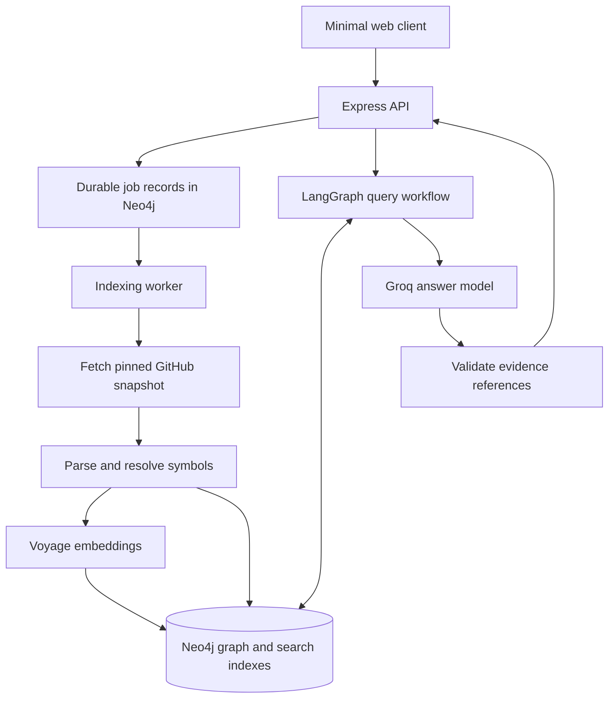

# AI Codebase Assistant Backend Design and Delivery Plan

Version 1.0 | 3 November 2026 | Proposed implementation baseline

> **Historical proposal:** this document captures the original plan and includes
> recommendations and folder layouts that were never implemented or have since
> changed. For the current system, use [backend-architecture.md](backend-architecture.md),
> [decisions.md](decisions.md), and [implementation-tracker.md](implementation-tracker.md).
> Deployment and evaluation work are currently deferred.

## 1 Product scope and decisions

We will build a repository understanding service. A user submits a public GitHub repository URL, waits for indexing, and asks questions about the indexed code. Answers identify supporting files and lines at a specific commit. The backend is the priority; the frontend provides only repository submission, progress, chat, and source references.

The initial scope is JavaScript, TypeScript and Python source, plus Markdown and selected project manifests. We support code lookup, symbol explanations, import and call relationships, and evidence-backed workflow explanations. Debugging responses suggest possible causes based on code; they do not claim to reproduce an error.

Neo4j is the only database in the initial design. It holds code chunks, embeddings, symbols, relationships, job records, and minimal conversation records. LangGraph controls retrieval steps; it does not store the repository dependency graph. We use one bounded read-only investigation workflow rather than multiple agents.

Excluded from version one: private repositories, arbitrary repository hosts, code execution, dependency installation, automated code changes, billing, autonomous fixes, Redis, PostgreSQL, and execution sandboxes. Containers may package our own services; this is separate from running untrusted repository code.

Acceptance means the user can submit a supported repository, observe a recoverable indexing job, ask grounded questions, inspect citations, refresh to a new commit, and delete stored repository data. All milestones below start as NOT STARTED. This document is a plan, not a record of implemented features.

## 2 Technology choices

- Runtime and language: supported Node.js LTS with TypeScript. Pin exact tested versions and commit the package lockfile.
- HTTP API: Express 5 with Yup request validation and a maintained OpenAPI contract.
- Workflow: LangGraph.js for explicit state, conditional retrieval, deadlines, and tool budgets. Use ordinary functions for deterministic steps.
- Graph and search: Neo4j with its JavaScript driver, uniqueness constraints, full-text indexes, and a vector index. Pin and integration-test database and driver versions; index syntax differs by version. [1]
- Parsing: Python uses a pinned Tree-sitter WASM grammar for static syntax extraction. JavaScript and TypeScript use the TypeScript Compiler API pinned to a tested compatible release for AST extraction and symbol resolution. Parse repository configuration as data; never load plugins, run builds, or execute project scripts. Missing dependencies reduce resolution coverage and must be reported. [4]
- Embeddings: begin the evaluation with Voyage voyage-code-4 at 1024 dimensions. Store model ID, dimensions, normalization version, and chunk hash. Query vectors and indexed vectors must use the same embedding configuration. [3]
- Answers: Groq through the native Groq chat completions HTTP API with strict structured JSON output. GROQ_ANSWER_MODEL defaults to qwen/qwen3.8-27b; the application caps context at 32000 tokens and reserves output and framing headroom.
- Tests: Vitest, Express HTTP contract tests, a disposable real Neo4j test instance, and parser fixtures.
- Operations: Pino structured logs, OpenTelemetry instrumentation, GitHub Actions CI, a managed Neo4j deployment, and a Linux host for the API and worker.
- Minimal UI: React, TypeScript, and Vite. No layout work blocks backend milestones.

LangChain adapters are optional conveniences. They are not another required service or orchestration layer. No Python service is needed.

## 3 Architecture and service boundaries

The Express API process also runs the indexing loop. Requests enqueue durable jobs and return a job ID immediately; indexing then processes the jobs asynchronously and reports progress. Parsing and embedding are bounded so individual operations yield between batches.

For the initial deployment, run one active indexing worker. A Neo4j transaction locks a job record, rechecks eligibility, and assigns a worker ID, lease expiry, and fencing generation. Heartbeats extend the lease. Every checkpoint verifies ownership; expired ownership cannot publish a snapshot. Test this behavior under two competing workers before enabling concurrency. A managed queue can replace this mechanism when scale warrants it; Redis is not required today.

Keep source chunks in Neo4j so answers do not depend on a surviving checkout. The downloaded workspace is temporary. Full-source download and graph browsing are not initial features. A future requirement to retain entire snapshots can introduce object storage without adding PostgreSQL.

API nodes are stateless. Query workflows need not resume after process failure in version one: record the failed run and let the user retry. Durable workflow checkpoints are a later requirement, not an assumed Neo4j integration.

## 4 Repository ingestion and safe processing

1. Accept only canonical HTTPS github.com owner/repository URLs. Reject embedded credentials, unsupported schemes, arbitrary download URLs, and malformed names. Construct download requests server-side; allow only expected GitHub endpoints and explicitly validated redirects.
2. Resolve the default branch to a commit SHA. Record the commit and indexing configuration before downloading. Enforce public access and never forward user-supplied credentials.
3. Fetch the pinned snapshot with byte and time limits. Validate archive paths, reject traversal and escaping symlinks, and enforce limits while extracting, not only after download. Do not initialize submodules or Git LFS downloads.
4. Enumerate allowed files. Skip node_modules, generated bundles, lockfiles for embedding, binaries, vendor directories, minified code, environment files, keys, and credential artifacts. Count ignored files and explain coverage. Secret scanning reduces exposure but cannot guarantee all secrets are detected.
5. Parse JS, JSX, TS, and TSX. Extract declarations, exports, imports, and statically resolvable calls. Store unresolved call sites explicitly. Markdown becomes documentation chunks.
6. Chunk by symbol, preserving signatures, enclosing scope, source location, and nearby imports. Split oversized functions at syntax boundaries. Starting target: 400 to 1,200 tokens per code chunk, with at most 100 tokens overlap when a split requires it. Test these values.
7. Compute content hashes; generate missing embeddings in bounded batches. Check provider input and batch limits independently of the answer model context window.
8. Write data idempotently into a BUILDING snapshot. Verify counts, reference integrity, vector dimensions, and index readiness. Test search visibility before activation.
9. Atomically mark the snapshot READY and update the repository active snapshot pointer. Existing questions remain pinned to their original snapshot. Failure leaves the previous READY snapshot available.

Recommended starting ceilings: 50 MiB compressed download, 200 MiB extracted content, 5,000 indexed source or documentation files, 1 MiB per input file, and 20,000 chunks. Stop with a clear limit error if any ceiling is exceeded. These are application policies to validate against memory and cost measurements, not platform capabilities.

## 5 Graph schema and version consistency

Core nodes: Repository, Snapshot, File, Symbol, CallSite, CodeChunk, IndexJob, Conversation, and QueryRun. Minimal identity and ownership records are required before public multi-user access.

Core relationships: Repository HAS_SNAPSHOT Snapshot; Snapshot HAS_FILE File; File DECLARES Symbol; Symbol HAS_CHUNK CodeChunk; File IMPORTS File; Symbol HAS_CALLSITE CallSite; CallSite RESOLVES_TO Symbol. Documentation chunks attach directly to File. Derived CALLS edges may support fast traversal but must retain call-site provenance.

Repository identity uses normalized host, owner, and name. Snapshot identity includes repository ID, commit SHA, parser version, chunking version, graph schema version, and embedding configuration. A symbol ID includes snapshot ID, normalized relative path, scope, kind, and declaration span. Symbol IDs are snapshot-specific; cross-version matching is a separate best-effort feature.

Duplicate names never collide. For overloaded functions, retain declaration signatures and the implementation grouping. A call edge is stored as resolved only when analysis supports it. Reflection, dynamic imports, injected services, JavaScript property dispatch, and missing external types can prevent resolution. An import edge never proves a runtime call.

Store resolution status and provenance on relationships. Distinguish resolved, candidate, external, and unresolved references. Do not invent numerical confidence scores without a calibrated method.

Every retrieval tool requires repository and snapshot scope from trusted server state. Do not accept arbitrary LLM-generated Cypher. Execute parameterized, reviewed query templates with maximum rows, depth, and execution timeout. Neo4j vector candidate search may need scoped over-fetch and post-filtering depending on the pinned version. Test cross-repository isolation and recall; never silently widen scope when too few matches remain.

Embedding changes create a new index generation and snapshot configuration. Never mix vector dimensions or models. Activate the new generation only after an evaluation and retain rollback access during migration.

## 6 Question answering and agent boundaries

The workflow is: validate access and snapshot; classify question; retrieve exact, lexical, and semantic candidates; merge ranks; traverse relevant relationships; pack evidence; assess gaps; optionally retrieve again; generate a structured answer; validate citations; return the result.

Begin with deterministic routing for paths, quoted names, and symbol references. Use an LLM planner only where it improves measured performance. Reciprocal rank fusion is a reasonable initial way to combine retrieval lists; raw lexical and vector scores are not directly comparable.

Tools are search_code, find_symbols, get_symbol, get_neighbors, and read_chunk. All are read-only and scoped. Tool inputs are schema-validated. The model may select a tool and refine a search, but cannot change access scope, execute shell commands, perform arbitrary network calls, or write graph data.

Graph expansion starts at one hop and can extend to two hops. Limit high-degree nodes and prefer relationship types relevant to the question. A broad architecture question retrieves representative entry points and module summaries; it does not traverse the entire graph.

Workflow state holds query ID, snapshot ID, intent, candidate IDs, selected evidence IDs, unresolved questions, consumed tokens, estimated cost, deadlines, and tool count. Avoid accumulating every retrieved snippet in state. Rebuild each prompt from selected evidence.

An ambiguous question such as “Where is validate called?” returns scoped candidates or asks for clarification. Weak evidence produces a limited answer with explicit unknowns. Runtime debugging without logs is described as a hypothesis, not a verified diagnosis.

Output fields: answer text, citations, snapshot SHA, limitations, warnings, and run ID. Citations reference backend-issued evidence IDs. The server maps them to immutable GitHub blob links and validates path, line span, and snapshot. Citation validity proves the source exists; it does not prove the source supports every generated claim. Evaluation must assess support separately.

## 7 Context window limits and cost controls

Never send the whole repository. Retrieval selects a small evidence set for each question. Configure the selected model context window, output ceiling, tokenizer, and provider limits centrally. Fail startup if required capability settings are missing.

The budget rule is: input tokens plus maximum output tokens plus applicable reasoning allowance plus safety reserve must fit the model context window. Token accounting depends on the selected model and API semantics. Count system messages, schemas, conversation history, metadata, source snippets, and tool results, not just code.

Illustrative request policy for a model verified to support at least 32,000 total tokens: 3,000 instructions and tool schemas; 3,000 question and conversation context; 14,000 source evidence; 2,000 evidence metadata; 4,000 output including applicable reasoning allocation; and 6,000 safety reserve. These are internal ceilings, not a claim about a particular model. Use less whenever possible. If reasoning requires a larger allowance, reduce input or select an appropriate tested configuration.

Before each model request, count tokens with a model-compatible tokenizer or supported counting mechanism. If overhead is uncertain, estimate conservatively and increase reserve. Trim low-value evidence first. Preserve signatures, exact error strings, call sites, and directly relevant code. Split broad questions into bounded subquestions rather than truncating arbitrary text.

Use the last few relevant turns and a compact conversation summary capped at 2,000 tokens. Preserve selected symbols and repository version separately as structured state. Summaries are navigation aids, never substitutes for source evidence. Re-retrieve code on follow-up questions and start a new scope when repositories change.

Starting limits per question: 20 lexical candidates, 20 vector candidates, up to 12 final evidence chunks within the token budget, two extra retrieval rounds, eight tool calls total, and a 60-second server deadline. Limit concurrency separately from token limits. Increasing any budget requires evaluation.

Track embedding tokens, model input and output usage, retries, elapsed time, and estimated money per job and query. Establish account-wide, per-user, and per-job budgets before exposure. Configure a small pilot spend ceiling and stop new expensive work before it is exhausted. Unknown or stale pricing must not be presented as an exact bill. Handle provider rate limits with bounded retry and reduced concurrency.

## 8 API contracts and job lifecycle

- POST /v1/repositories accepts a GitHub URL and idempotency key; returns 202 with repository and job IDs, or an existing compatible READY snapshot.
- GET /v1/jobs/:id returns stage, counters, warnings, timestamps, and a safe error code. Percentage is shown only when total work is known.
- GET /v1/repositories/:id returns active commit, supported coverage, and available snapshot status.
- POST /v1/repositories/:id/refresh resolves the branch and starts a new snapshot job when necessary.
- POST /v1/repositories/:id/questions accepts question, conversation ID, and optional permitted snapshot ID. It returns a grounded answer or a typed error.
- GET /v1/repositories/:id/symbols supports scoped disambiguation. DELETE /v1/repositories/:id schedules controlled cleanup.
- GET /health/live checks the process. GET /health/ready checks critical configuration and database availability; do not call the LLM on every probe.

Job states: QUEUED, FETCHING, PARSING, EMBEDDING, VERIFYING, READY, FAILED, CANCELLED. Persist stage checkpoints, attempt counts, lease ownership, and error details. Writes must be idempotent because retries can repeat work. Cancellation stops new batches and prevents activation; it cannot undo an already billed external request.

Errors use a stable shape: code, safe message, retryable, requestId, and optional jobId. Use 400 for invalid input, 403 for denied access, 404 for missing resources, 409 for conflicting state, 413 for limits, 429 for throttling, and 503 for temporary dependency failure. Do not expose stack traces or provider keys.

Fetch active indexing progress from the API every three seconds, stopping after a terminal status or request error. Keep Neo4j as the durable job state. Return complete validated answer responses; do not stream unvalidated answer claims as final content. Answer streaming can follow once citation handling is designed.

## 9 Failure handling and recovery

Provider requests use no automatic retries. A failed job can be explicitly refreshed, while expired worker leases have at most three claims. Do not repeatedly retry authentication, exhausted quota, malformed input, dimension mismatch or budget failures. Requests remain bounded by deadlines.

If a repository is unavailable or becomes private, fail the new fetch clearly. If some supported files cannot parse, report file-level warnings and coverage; a failed critical integrity check prevents activation. A single malformed optional documentation file need not discard an otherwise valid snapshot.

If embeddings fail, checkpoint successful batches and retry only missing chunks. Reuse an embedding only when normalized content and full embedding configuration match. If the worker crashes, its lease expires and work resumes from durable checkpoints. Cleanup removes abandoned temporary files and old BUILDING snapshots after a retention interval.

If vector search is unavailable, exact and full-text search may provide a declared degraded mode. If the graph database is unavailable, return a dependency error; do not answer from model memory as if grounded. If the answer provider is unavailable, optionally return retrieved references with a clear explanation that generation failed.

If a generated citation is invalid, attempt one repair within the same cost and time budget. Otherwise remove unsupported claims or return a safe failure. If the context limit is rejected, repack once conservatively; repeated rejection ends the run. Every route must terminate by deadline.

Provide operator runbooks for stuck jobs, provider outages, database connectivity, index failures, runaway spend, and bad releases. Each includes detection, containment, recovery, and the verification query. User reports include a run ID so maintainers can trace the issue without asking users to disclose code in logs.

## 10 Testing and acceptance gates

Create small controlled repositories with duplicate function names, overloads, aliases, re-exports, barrel files, cyclic imports, monorepo paths, async handlers, unresolved external modules, dynamic calls, broken syntax, generated files, and prompt-injection comments. Add archive path traversal, symlink, oversized-file, and cross-scope access fixtures.

Unit tests verify symbol identity, chunk boundaries, token packing, URL validation, and budget enforcement. Integration tests use a real pinned Neo4j instance for constraints, vector and full-text retrieval, scope filtering, transaction races, and snapshot activation. Mock provider errors deterministically; run a small real-provider suite only with an explicit test budget.

End-to-end tests submit a controlled repository, poll to READY, ask known questions, verify citations against the commit, refresh changed files, simulate restart, and delete data. Fault tests interrupt workers, inject 429 and 503 responses, expire leases, disable indexes, and disconnect the database. Load tests measure API latency while indexing and query work compete.

Build at least 60 reviewed questions across three small or medium repositories, with expected files, symbols, acceptable answers, and unanswerable cases. Keep at least 20 questions held out from prompt tuning. Evaluate retrieval independently from answer generation. Use human review for source support; an LLM judge can assist but is not the sole acceptance authority.

Proposed release gates: at least 90 percent expected-evidence recall in the top 10 results; 100 percent mechanically valid citations; at least 90 percent reviewed answers with no material unsupported claim; at least 90 percent correct abstention on deliberately unanswerable questions; and zero cross-repository access leaks in the adversarial suite. Publish counts and failure categories, not only percentages. These are targets to validate, not current results.

Performance targets for a defined pilot workload: question p95 below 30 seconds and hard deadline 60 seconds; a 1,000-source-file fixture indexes within 10 minutes on the specified host. Record host size, provider latency, concurrency, and cold or warm state. Revise scope or architecture if targets fail rather than hiding failures.

## 11 Deployment and operational reliability

Recommended pilot topology: one Linux VM with persistent service configuration, running separate API and worker services, plus managed Neo4j over TLS. Serve the minimal frontend from the API or static hosting. This is a single-host application deployment with a known host failure risk; it is not high availability.

Use containers for reproducible packaging of our services or managed process services if preferred. Neither option executes uploaded repository code. Pin images and dependencies, run as a non-root user, use a read-only application filesystem where practical, and place scratch downloads in quota-limited temporary storage. Keep secrets in the host or provider secret manager, never frontend bundles or repository files.

CI gates: lint, typecheck, unit tests, real-database integration tests, API contract tests, and a small deterministic end-to-end suite. Run paid answer evaluations on controlled release candidates. Build one immutable release artifact, deploy to staging, apply additive graph schema and index migrations, run smoke tests, then promote the same artifact to production.

Before public access, require authenticated ownership or restricted pilot access, request and spend quotas, scoped queries, HTTPS, request-size limits, and a tested deletion path. A public source repository does not make user chats public. Inform users that selected code is sent to the embedding and answer provider. Repository content is untrusted data; instructions found in comments or README files cannot override system policy or tool permissions.

Log request, job, snapshot, and run IDs with stage durations, retries, unresolved-reference counts, token usage, and safe error codes. Do not log raw source, full prompts, credentials, or chats by default. Monitor error rate, question latency, queue age, job failures, database latency, disk use, rate limits, and daily spend. Alert on sustained failures and budget thresholds.

Take database backups supported by the chosen Neo4j service tier and test restoration in staging. Initial proposed recovery objectives are 24-hour recovery point and 4-hour recovery time; neither is promised until demonstrated. Source can be reindexed, but chats and job metadata require backups. Roll back application releases to the previous artifact and repository pointers to the prior compatible READY snapshot. Avoid destructive migrations during routine deploys.

## 12 Step by step delivery tracker

All items are NOT STARTED. Mark a milestone complete only when its evidence and exit gate exist. Implement backend slices first; a CLI or API client is enough until milestone 9.

1. [ ] Architecture baseline. Create the monorepo, configuration schema, dependency lockfile, CI, and decision records. Validate one Neo4j vector and full-text query and one embedding request. Exit: reproducible local setup and compatibility record.
2. [ ] Controlled parser. Build AST extraction, snapshot-scoped IDs, imports, call sites, and resolution warnings. Exit: duplicate-name, alias, overload, and unresolved-call fixtures pass without executing project code.
3. [ ] Durable ingestion. Add URL validation, bounded download, extraction defenses, job states, checkpoints, cancellation, and cleanup. Exit: restart and malicious-archive tests pass; failed work cannot become READY.
4. [ ] Searchable graph. Add constraints, chunk storage, embedding batches, vector and full-text indexes, and snapshot activation. Exit: idempotent retries and two-repository isolation tests pass.
5. [ ] Retrieval baseline. Implement exact lookup, hybrid ranking, scoped graph traversal, and symbol disambiguation without answer generation. Exit: initial reviewed retrieval dataset meets the recall gate or documents changes needed.
6. [ ] Grounded answers. Add the answer model, structured output, immutable citations, uncertainty, and abstention. Exit: citation checks and reviewed grounding evaluation pass.
7. [ ] Bounded investigation. Add LangGraph state, optional repeat retrieval, context packing, token and cost budgets, and deadlines. Exit: broad and adversarial questions always terminate within limits.
8. [ ] Updates and lifecycle. Add refresh, content-hash reuse, retained previous snapshots, conversation scoping, and repository deletion. Start with full reparse plus embedding reuse; optimize dependency invalidation only after correctness. Exit: changed and removed symbols never leak into the new snapshot.
9. [ ] Thin frontend integration. Add URL submission, three-second progress polling, repository chat, and source links. Exit: end-to-end public repository flow works; no layout polish is required.
10. [ ] Reliability and restricted staging. Add access controls, quotas, telemetry, fault tests, release automation, and runbooks. Exit: staging smoke tests, worker recovery, and backup restore are demonstrated.
11. [ ] Pilot release. Run held-out quality tests and workload tests, set budgets, document known analysis limits, and deploy to a restricted pilot. Exit: release gates pass and an operator can recover a failed job using the runbook.
12. [ ] Version one completion. Fix pilot blockers, repeat affected evaluations, validate refresh and deletion, and record release evidence. Exit: every promised capability works and remaining limitations are visible to users.

Do not assign calendar commitments before the parser and retrieval spikes establish effort. Track each item with owner, status, issue link, test evidence, blocker, and completion date. Passing a demo does not replace the milestone exit gate.

## 13 Project structure and deferred decisions

Suggested structure: apps/api, apps/worker, apps/web, packages/contracts, packages/config, packages/ingestion, packages/code-analysis, packages/graph, packages/retrieval, packages/workflow, and tests/fixtures. Keep database access behind scoped repositories and model access behind a provider adapter.

Maintain decision records for Neo4j-only persistence, snapshot identity, supported language coverage, embedding configuration, model selection, context budgets, job ownership, and deployment topology. Record alternatives and the evidence that would justify revisiting each decision.

Open implementation choices: exact model and token settings, hosting region and machine size, Neo4j service tier, authentication provider, retention periods, and monetary quotas. Use restricted staging until these are set. Costs must be estimated from measured chunks, usage, and current provider prices; a fixed monthly estimate without workload data would be misleading.

Expansion triggers: introduce a managed queue when durable single-worker operation becomes a throughput or operational bottleneck; object storage when retaining full snapshots becomes a requirement; more API instances when measured traffic justifies availability and load distribution; PostgreSQL when transactional product features justify a separate relational store. Additional languages require language-specific resolution tests. None of these is automatically required for version one.

## 14 Technical references

Official documentation checked on 3 November 2026. Numerical policies and release targets above are design proposals, not vendor guarantees.

[1] Neo4j search indexes: https://neo4j.com/docs/cypher-manual/current/indexes/search-indexes/

[2] LangGraph JavaScript workflow design: https://docs.langchain.com/oss/javascript/langgraph/thinking-in-langgraph

[3] Voyage embeddings guide: https://docs.voyageai.com/docs/embeddings

[4] TypeScript Compiler API: https://github.com/microsoft/TypeScript/wiki/Using-the-Compiler-API

LangGraph supports connecting discrete nodes through shared state; our bounded retrieval workflow is an application-specific design built on that capability. [2] Voyage embedding configuration and Neo4j index compatibility must be checked against the pinned deployment during milestone 1. [1][3]

Current provider contract: Groq requests use conservative UTF-8 byte bounds and framing reserves before generation, rather than a remote token-count endpoint. Actual token usage comes from the completed response. Both providers use native fetch with deadlines, bounded response sizes and no automatic retries. See decisions.md and embedding-policy.md for current implementation details.

Current supported profiles and source limits are defined in supported-repositories.md. MERN/React/Express sources and Python Flask/FastAPI modules are targets for static exploration. Framework execution, arbitrary dispatch and dependency injection remain outside verified static behavior. The page provides public example links and URL-fill buttons. Deployment is deferred by user choice; implementation-tracker.md records current verification rather than the original milestone checklist.
